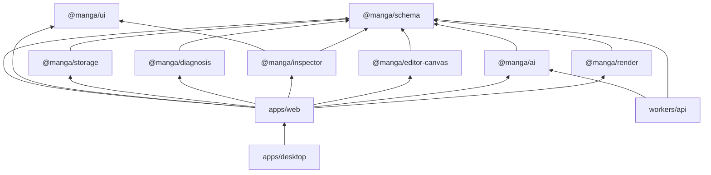

# 02. アーキテクチャ

## 技術スタック

| 層 | 選定 | 補足 |
|---|---|---|
| UI | React 19, TypeScript strict | |
| ルーティング | TanStack Router (file-based) | Web と Desktop で同一ルート |
| 状態 | Zustand + Immer。共同編集時は Yjs | どちらの store も `applyPatch` インターフェース越しに操作するので、呼び出し側は同じコードで動く |
| キャンバス | 自前 SVG | コマ割り、フキダシ、焦点は矩形と点とベクトルだけなので十分。生成画像は `<image>` で枠内にクリップ表示。tldraw や Konva は使わない |
| レンダラ | Canvas 2D（`OffscreenCanvas`、Web Worker） | 出力画像の合成。縦書きは 1 文字ずつ配置する自前実装。フォントは Noto Sans JP を同梱 |
| スキーマ | Zod | 型、バリデーション、JSON Schema 生成の元 |
| Desktop | Tauri 2 | ファイル保存、ネイティブダイアログ |
| API | Cloudflare Workers + Hono | AI プロキシ、プロジェクト CRUD、アセット、共同編集の同期 |
| DB | Cloudflare D1 | 利用量、プロジェクトのメタ情報とドキュメント JSON |
| ファイル | Cloudflare R2 | 生成画像、参照画像、PDF |
| 共同編集 | Durable Objects + Yjs | |
| 認証 | Better Auth（workers/api 上、Google OAuth） | ユーザーとセッションは D1。`06-open-questions.md` 参照 |
| 画像生成 | 外部 API。プロバイダ抽象の裏に置く | 参照画像入力が必須。一括生成はページ単位、1 コマの生成と修正はコマ単位で呼ぶ |
| LLM | 外部 API。プロバイダ抽象の裏に置く | 脚本からの下書きと診断の言語化 |
| PDF | pdf-lib | レンダラが描いたページ画像を並べる |
| モノレポ | pnpm workspaces。Turborepo は不採用 | パッケージ単位の build を持たず apps と Vitest がソースを直接読むため、タスク順序もキャッシュも不要 |
| テスト | Vitest, Playwright | |
| Lint / Format | Biome | |

## リポジトリ構成

```
manga/
├── apps/
│   ├── web/            # Vite + React + TanStack Router。Web ビルド
│   └── desktop/        # Tauri 2。apps/web をラップし、ストレージアダプタだけ差し替える
├── packages/
│   ├── schema/         # Zod スキーマ、型、フィクスチャ、マイグレーション。全パッケージの唯一の共通依存
│   ├── render/         # 決定論的レンダラ。Page -> PNG、配置図 PNG、Page[] -> PDF
│   ├── ai/             # 画像生成と LLM のプロバイダ抽象、プロンプト構築、クライアント
│   ├── editor-canvas/  # SVG キャンバス。コマ割り、フキダシ、焦点、ベクトル、生成画像、オーバーレイの描画と操作
│   ├── inspector/      # 右ペインのフォーム群。Panel / Bubble / FocusPoint / Character の編集 UI
│   ├── diagnosis/      # 純粋関数。Page -> PageDiagnosis。補助
│   ├── storage/        # StorageAdapter インターフェースと実装（IndexedDB / Tauri FS / Cloud）
│   └── ui/             # 共通コンポーネント、テーマ
├── workers/
│   └── api/            # Hono。AI プロキシ、利用量、認証、プロジェクト CRUD、アセット、同期
└── docs/
```

依存の向きは一方向に固定する。



`packages/*` は `schema` 以外を import しない。例外は `inspector` が `ui` の部品を使うことと、`workers/api` が `packages/ai` のプロンプト構築を使うこと。横の連携は `apps/web` が props と callback で配線する。

## レイヤー構造（キャンバス）

下から順に。

| 層 | 内容 | 編集 | データの所在 | 出力画像に出るか |
|---|---|---|---|---|
| Reference | 参考画像 | 不透明度と表示切替のみ | `Page.reference` (参照 + 不透明度)。本体は Blob / R2 | 出ない |
| Art | コマごとの生成画像。コマ枠でクリップ | 生成、再生成、履歴の切替 | `Panel.arts[]`, `Panel.artId` | 出る |
| Scribble | 手描きメモの線 | 描く、消す、取り消す | `Page.scribbles` | 出ない |
| Panels | コマ枠 | 矩形操作、分割、結合、順序 | `Page.panels[].rect` | 出る |
| Bubbles | フキダシとセリフ | ドラッグ、リサイズ、追加、削除 | `Panel.bubbles` | 出る |
| Hints | 焦点、ベクトル | ドラッグ、追加、削除 | `Panel.focusPoints`, `Panel.vectors` | 出ない |
| Diagnosis overlay | 視線経路、t 値、OK / miss、bubble chain。今は出さない（`06-open-questions.md` の 2026-10-17） | 表示のみ | 計算結果。保存しない | 出ない |

キャンバスは編集のための表示であり、出力画像は `packages/render` が同じデータから別に作る。両者の見た目は「コマ枠、絵、フキダシ、セリフ」について一致させる。

## Web と Desktop の差分

| 関心事 | Web | Desktop |
|---|---|---|
| プロジェクト保存 | IndexedDB（ローカル）とクラウド | ローカルファイル（`.manga.json` + 同名ディレクトリに画像）とクラウド |
| 画像の置き場 | Blob を IndexedDB、同期時に R2 | ファイルシステム、同期時に R2 |
| 認証 | ブラウザのセッション | 同じ Web フローを WebView で実行し、トークンを Tauri の secure storage に保存 |
| AI 呼び出し | Workers 経由 | Workers 経由（同じ） |
| オフライン | 編集、診断、合成、PNG / PDF 出力は可能。生成は不可 | 同左 |

差分は `packages/storage` の `StorageAdapter` 実装の選択と、認証トークンの保存先だけに閉じ込める。

## データフロー

### 編集

```
ユーザー操作
  -> editor-canvas / inspector が onChange(patch) を発火
  -> apps/web の store が applyPatch で Project を更新
  -> diagnosis が Page から PageDiagnosis を再計算（useMemo、純粋関数）
  -> editor-canvas が Page + PageDiagnosis + 生成画像を描画
  -> storage が debounce して永続化
```

### 生成（コマ 1 つ）

```
コマの「生成」「修正して再生成」ボタン
  -> render.renderLayoutPng(page, panelId)   コマ枠とフキダシ領域を白抜きした配置図
  -> ai.prompts.panelArt(...)                note、camera、キャラ外見、焦点、誘導線、診断ヒント、スタイルから文章を組む
  -> ai.createHttpImageProvider(opts).generatePanelArt   Workers 経由で外部 API。参照画像、前回の絵、修正指示を添付
  -> storage.putAsset(image)                 ref を得る
  -> applyPatch([ add Panel.arts[], replace Panel.artId ], { source: 'ai' })
```

### 生成（ページ、エピソードの一括）

```
「このページを全部生成」などの一括ボタン（エピソードはページに分解して並列に呼ぶ）
  -> render.renderPageLayoutPng(page)        ページ全体のコマ枠とフキダシ領域を白抜きした配置図
  -> ai.prompts.pageArt(...)                 コマごとの読み順とページ内の範囲、note、camera、登場キャラ、焦点、誘導線、診断ヒント、スタイル
  -> ai.createHttpImageProvider(opts).generatePageArt    Workers 経由で外部 API を 1 回。ページの参考画像とキャラの参照画像を添付
  -> render.cropPanelArts(page, image)       コマの枠の矩形で切り抜く
  -> storage.putAsset(crop)                  コマごとに ref を得る
  -> applyPatch([ コマごとに add Panel.arts[], replace Panel.artId ], { source: 'ai' })   1 回の Undo で戻る
```

利用量はページ 1 回の生成を 1 回と数える。

生成は store の外で行い、結果だけを Patch で入れる。Undo で生成前に戻せる。アセットは残る。

### 出力

```
「書き出し」
  -> render.renderPage(page, { resolveAsset, dpi })   Canvas 2D で合成。Web Worker
  -> PNG はそのまま保存
  -> PDF は render.exportPdf が各ページの画像を pdf-lib で束ねる
```

合成はクライアント側で完結する。サーバは要らない。
