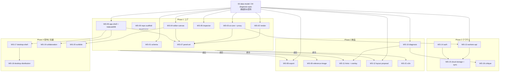

# 05. ワークストリームと並列進行

## 原則

1. **契約先行。** `03-data-model.md` と `04-diagnosis-spec.md` を凍結してから着手する。各 WS はこの 2 つと自分のブリーフだけで完結する。
2. **待たない。** 他 WS の成果物はモックかフィクスチャで代替する。`docs/fixtures/sample-page-01.json` が共通の入力。
3. **パッケージ境界を越えない。** `packages/*` は `packages/schema` 以外を import しない。横の連携は `apps/web` が配線する。
4. **Phase 末に統合。** 統合は専任 1 名が `apps/web` で行う。各 WS は統合前に自分の受け入れ条件を自分で満たす。
5. **ブリーフが仕様。** 迷ったらブリーフに書き足して PR を出す。口頭合意は残さない。

## Phase の狙い

| Phase | 狙い | 到達点 |
|---|---|---|
| 1 コア | コマとフキダシとセリフを入力し、コマの絵を生成し、合成したページ PNG を出す | フィクスチャを読み込み、6 コマを生成し、ネーム画像 1 枚を保存できる |
| 2 納品 | PDF、修正ループ、キャラの一貫性、参考画像、診断ヒント、脚本からの下書き | 原作者がエピソード 1 本を PDF にして漫画家に送れる |
| 3 クラウド | 認証、プロジェクトのクラウド保存、利用量管理 | 複数端末で同じプロジェクトを開ける |
| 4 配布と協業 | Desktop、署名配布、共同編集、手描きメモ | 漫画家や編集者が同じプロジェクトを見て赤を入れられる |

## 全体マップ

詳細は [07-dependencies.md](07-dependencies.md)。ここは概観のみ。

実線は「統合時に必要」、点線は「開発中は不要」。**開発着手時点の依存は DOC のみ** が Phase 1 全部と WS-08, WS-10, WS-12, WS-13 に成り立つ。これらは今日から全部同時に始められる。

## 一覧

| WS | 名前 | Phase | パッケージ | 開発中の依存 | 統合時の依存 |
|---|---|---|---|---|---|
| 00 | [repo scaffold](workstreams/WS-00-repo-scaffold.md) | 1 | ルート | なし | なし |
| 01 | [schema](workstreams/WS-01-schema.md) | 1 | packages/schema | DOC | なし |
| 02 | [render](workstreams/WS-02-render.md) | 1 | packages/render | DOC | 01 |
| 03 | [ai-core](workstreams/WS-03-ai-core.md) | 1 | packages/ai, workers/api | DOC | 01 |
| 04 | [editor-canvas](workstreams/WS-04-editor-canvas.md) | 1 | packages/editor-canvas | DOC | 01 |
| 05 | [inspector](workstreams/WS-05-inspector.md) | 1 | packages/inspector | DOC | 01 |
| 06 | [app-shell](workstreams/WS-06-app-shell.md) | 1 | apps/web, packages/storage | DOC | 01, 04, 05 |
| 07 | [panel-art](workstreams/WS-07-panel-art.md) | 1 | apps/web | DOC | 02, 03, 04, 06 |
| 08 | [export](workstreams/WS-08-export.md) | 2 | packages/render, apps/web | DOC | 02, 06 |
| 09 | [reference-image](workstreams/WS-09-reference-image.md) | 2 | editor-canvas, storage, apps/web | DOC | 04, 06, 07 |
| 10 | [diagnosis](workstreams/WS-10-diagnosis.md) | 2 | packages/diagnosis | DOC | 01 |
| 11 | [hints-overlay](workstreams/WS-11-hints-overlay.md) | 2 | editor-canvas, inspector, apps/web | DOC | 04, 05, 07, 10 |
| 12 | [layout-proposal](workstreams/WS-12-layout-proposal.md) | 2 | packages/ai, apps/web | DOC | 03, 06 |
| 13 | [workers-api](workstreams/WS-13-workers-api.md) | 3 | workers/api | DOC | 03, 14 |
| 14 | [auth](workstreams/WS-14-auth.md) | 3 | workers/api, apps/* | 未決事項の決定 | 13 |
| 15 | [cloud-storage](workstreams/WS-15-cloud-storage.md) | 3 | packages/storage | DOC | 06, 13, 14 |
| 16 | [critique](workstreams/WS-16-critique.md) | 3 | packages/ai, apps/web | DOC | 03, 10, 11 |
| 17 | [desktop-shell](workstreams/WS-17-desktop-shell.md) | 4 | apps/desktop, packages/storage | DOC | 06 |
| 18 | [desktop-distribution](workstreams/WS-18-desktop-distribution.md) | 4 | apps/desktop, CI | なし | 17 |
| 19 | [collaboration](workstreams/WS-19-collaboration.md) | 4 | workers/api, packages/storage | DOC | 06, 13 |
| 20 | [scribble](workstreams/WS-20-scribble.md) | 4 | editor-canvas | DOC | 04 |
| 21 | [e2e-hardening](workstreams/WS-21-e2e-hardening.md) | 2〜 | ルート | なし | Phase 1 統合 |

「開発中の依存」が DOC だけのものは、他に何も待たずに着手できる。

## 各 WS に共通する成果物

- パッケージ本体と `README.md`（公開 API、使い方、モックの差し替え方）。
- Vitest のユニットテスト。UI パッケージは `src/dev/` に単体起動できる Vite プレイグラウンド。
- `docs/fixtures/sample-page-01.json` を読み込んで動く状態。
- ブリーフの「受け入れ条件」を満たしたことを PR 本文に列挙。

## モックの約束

| 必要なもの | 代替 |
|---|---|
| `packages/schema` の型 | `03-data-model.md` の型を自パッケージ内 `src/contract.ts` に写して使う。統合時に import に置換 |
| 生成画像 | `docs/fixtures/art/pn_1.png` 〜 `pn_6.png`（WS-03 が `FakeImageProvider` と一緒に commit する。灰色の矩形にコマ番号を描いただけの PNG で可） |
| `ImageProvider` / `LlmProvider` | 固定レスポンスを返す `FakeImageProvider` / `FakeLlmProvider`（WS-03 がコントラクトに同梱。それまでは自前） |
| `packages/diagnosis` の出力 | `docs/fixtures/sample-page-01.diagnosis.json`（WS-10 が最初に生成して commit する。それまでは `diagnosis: null`） |
| `StorageAdapter` | `packages/storage` の `MemoryStorageAdapter`（WS-06 が最初に commit する。それまでは自前のインメモリ実装） |
| Workers API | `wrangler dev` のローカル実行、または `msw` でモック |

## 統合手順（Phase 末）

### Phase 1 統合
1. WS-00 の scaffold に全パッケージを取り込む。各パッケージの `src/contract.ts` を `@manga/schema` の import に置換する。
2. `apps/web` で `editor-canvas` + `inspector` + `storage(IndexedDB)` + `ai(Fake)` + `render` を配線する。
3. フィクスチャをロードし、6 コマを Fake で生成し、合成した PNG を保存して目視確認する。
4. Workers のプロキシを `wrangler dev` で起動し、Fake から実プロバイダに切り替えて 1 コマ生成する。

### Phase 2 統合
1. エピソード 1 本を PDF にし、Preview.app と Acrobat で開く。
2. 修正指示つき再生成、履歴切替、参考画像の添付を通しで確認する。
3. 診断オーバーレイを表示し、ヒントがプロンプトに入っていることをログで確認する。
4. 脚本から下書きを作り、承認し、生成し、PDF にするまでを 1 本通す。

### Phase 3 統合
1. `workers/api` をデプロイし、認証を通す。共有トークンを廃止する。
2. `storage(Cloud)` に切り替えてもローカル版と同じ操作ができることを確認する。
3. 利用量が記録され、上限で止まることを確認する。

### Phase 4 統合
1. Desktop の署名済みビルドで Phase 1 の全操作と生成が動く。
2. 共同編集を有効にしても Phase 1 の単体操作が壊れないことを E2E で確認する。

## 定義

- **DOC**: `03-data-model.md` と `04-diagnosis-spec.md`。
- **統合担当**: Phase 末に `apps/web` で配線する人。各 WS の担当とは別でよい。
- **受け入れ条件**: ブリーフ末尾の箇条書き。全部満たすまで Done にしない。
