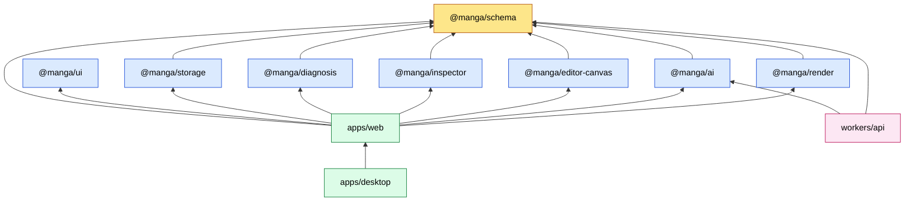
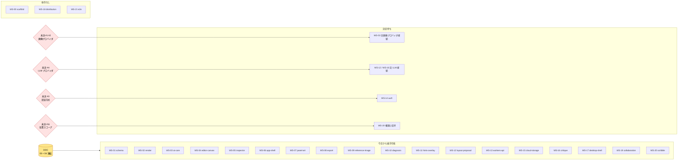
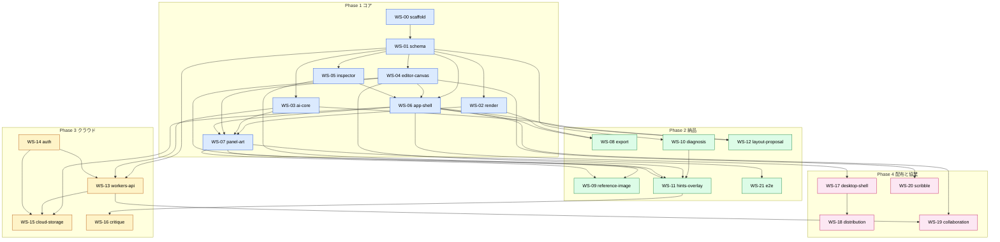
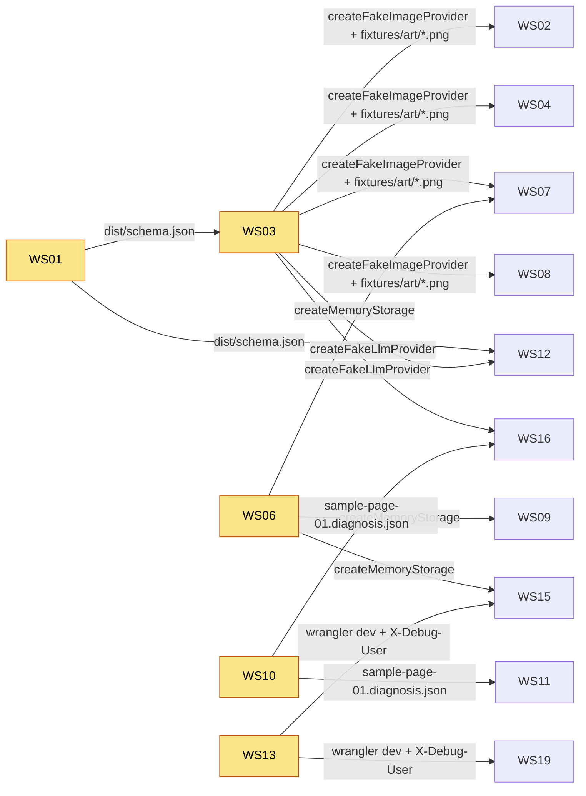

# 07. 依存関係図

3 種類の依存を分けて描く。混ぜると「着手に必要なもの」と「統合に必要なもの」の区別がつかなくなる。

1. パッケージの import 依存（コード上の制約）
2. ワークストリームの着手時依存（今日から始められるかどうか）
3. ワークストリームの統合時依存（Phase 末に何が揃っている必要があるか）

## 1. パッケージの import 依存

`packages/*` は `schema` 以外を import しない。横の配線は `apps/web` が担う。`workers/api` だけは `ai` のプロンプト構築を使う。

## 2. 着手時依存

矢印の元が揃えば着手できる。`DOC` は `03-data-model.md` と `04-diagnosis-spec.md`。
`DOC` だけに依存するものは、今日から全部同時に始められる。

WS-03、WS-12、WS-16、WS-19 は Fake プロバイダや Yjs のローカル動作までは今日から進められる。実プロバイダ接続と権限設計だけが決定待ち。

## 3. 統合時依存

Phase 末に `apps/web` で配線するときに揃っている必要があるもの。矢印は「元が先に完成している必要がある」。

## 4. モックの供給関係

誰が最初に何を commit すると、誰が解放されるか。

供給側は、自分の本体が完成していなくてもモックだけ先に commit する。各ブリーフにその旨を書いてある。
