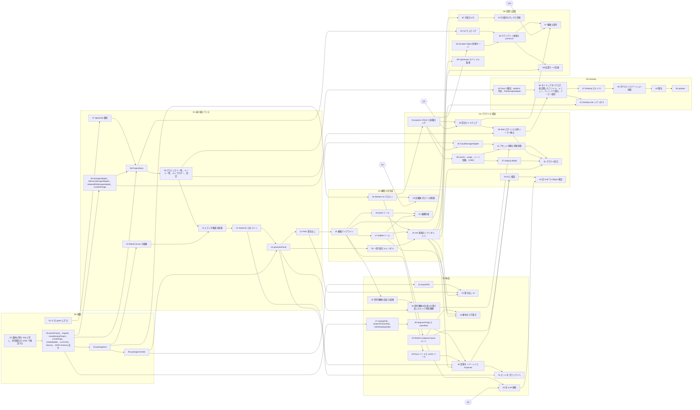

# 08. タスク

AI エージェントに 1 つずつ渡す単位に切ったタスク一覧。正は `tasks.json` で、この文書は `make tasks render` で生成する。手で編集しない。

## 原則

1. 1 タスク = 1 セッション = 1 PR。範囲外のディレクトリは触らない
2. 実装が終わったらそのまま Done にする。テストや pnpm check は走らせない
3. main は毎タスク後も `pnpm check` が通り、apps/web が起動する
4. 仕様欄のブリーフと契約を読んでから着手する。ブリーフにある contract.ts、モック置換、Phase 末統合の記述は無視する

各タスクは次を持つ。

| 項目 | 内容 |
|---|---|
| 依存 | 先に Done になっている必要があるタスク。`Q*` は `06-open-questions.md` の決定待ち |
| 範囲 | 触ってよいディレクトリ |
| 完了条件 | 実装が満たすべき条件。Done の判定には使わない |
| 仕様 | 着手前に読む文書 |

`05-workstreams.md` の WS ブリーフは仕様として読む。ブリーフにある `contract.ts` への型の写し、モックの置換、Phase 末の統合はこの一覧には無い。schema を最初に終わらせて全員がそれに依存し、毎タスクで apps/web に配線する。

## 進め方

| コマンド | 内容 |
|---|---|
| `make tasks next` | 着手できるタスクを列挙する |
| `make tasks show <id>` | 依存、範囲、完了条件、仕様を表示する |
| `make tasks start <id>` | 着手にする。依存が未完了なら拒否 |
| `make tasks done <id>` | 完了にする。検証はしない |

タスク総数 59。G0 と G1 は直列で、ここがクリティカルパス。G2 以降は依存が揃った順に並列に出せる。

| 節目 | 条件 | 到達したら |
|---|---|---|
| [ ] M1 | 14 が Done | フィクスチャを読み込み、6 コマを Fake で生成し、合成したページ PNG を保存できる |
| [ ] M2 | 19, 20, 22 が Done | 実プロバイダでページを一括生成し、PNG にでき、e2e 1〜3 が CI で通る |
| [ ] M3 | 24, 26, 31, 33, 34 が Done | エピソード 1 本を PDF にして漫画家に渡せる。参考画像、診断ヒント、脚本からの下書きが動く |
| [ ] M4 | 42, 44 が Done | 認証とクラウド保存が実 API で動き、AI に相談できる |
| [ ] M5 | 50, 51, 58 が Done | 署名済み Desktop 配布と共同編集が e2e で通る |

## 進捗

完了 5 / 着手中 0 / 未着手 54

### G0 基盤

- [x] 01 CI を green にする（完了 2026-10-15）
- [x] 02 契約の型を Zod に写し、参照整合を refine で検証する（完了 2026-10-15）
- [x] 03 parseProject、migrate、createEmptyProject、createPage、createBubble、currentArt、fixtures、JSON Schema 出力（完了 2026-10-15）
- [x] 04 packages/ai（完了 2026-10-15）
- [ ] 05 packages/render

### G1 最小縦スライス

- [ ] 06 StorageAdapter、MemoryStorageAdapter、IndexedDbStorageAdapter、createStorage
- [x] 07 apps/web 雛形（完了 2026-10-15）
- [ ] 08 ProjectStore
- [ ] 09 プロジェクト一覧、ページ一覧、キャラクター、設定
- [ ] 10 EditorCanvas の描画
- [ ] 11 エディタ画面の配線
- [ ] 12 Inspector と右ペイン
- [ ] 13 generatePanel
- [ ] 14 PNG 書き出し

### G2 編集と実生成

- [ ] 15 編集パイプライン
- [ ] 16 panel ツール
- [ ] 17 bubble ツール
- [ ] 18 Workers AI プロキシ
- [ ] 19 実画像プロバイダ接続
- [ ] 20 一括生成とキャンセル
- [ ] 21 描画性能
- [ ] 22 e2e 基盤とシナリオ 1, 2, 3

### G3 納品

- [ ] 23 exportPdf
- [ ] 24 書き出し UI
- [ ] 25 参考画像の読込と描画
- [ ] 26 参考画像の生成への受け渡しとキャラ参照画像
- [ ] 27 sweepPath、projectOntoSweep、inferReadingOrder
- [ ] 28 diagnosePage と panelHint
- [ ] 29 focus ツールと vector ツール
- [ ] 30 診断オーバーレイと Inspector
- [ ] 31 ヒントをプロンプトへ
- [ ] 32 Workers propose-layout ルート
- [ ] 33 脚本から下書き
- [ ] 34 実 LLM 接続

### G4 クラウドと相談

- [ ] 35 projects CRUD と楽観ロック
- [ ] 36 assets、usage、レート制限、CORS
- [ ] 37 staging deploy
- [ ] 38 認証ミドルウェア
- [ ] 39 Web ログインと共有トークン廃止
- [ ] 40 CloudStorageAdapter
- [ ] 41 アセット同期と同期状態
- [ ] 42 クラウド統合
- [ ] 43 AI に相談
- [ ] 44 実 LLM で critique 検証

### G5 Desktop

- [ ] 45 Tauri 2 雛形、platform 判定、FileStorageAdapter
- [ ] 46 ネイティブダイアログ、最近開いたファイル、メニュー、ウィンドウ復元、トークン保存
- [ ] 47 Desktop ビルド CI
- [ ] 48 タグビルドとバージョン同期
- [ ] 49 署名
- [ ] 50 updater
- [ ] 51 Desktop e2e シナリオ 8

### G6 協業と品質

- [ ] 52 手描きメモ
- [ ] 53 手描きのタッチと性能
- [ ] 54 Yjs マッピング
- [ ] 55 Durable Object 同期サーバ
- [ ] 56 クライアント接続と presence
- [ ] 57 権限と招待
- [ ] 58 協業モード回帰
- [ ] 59 Lighthouse とバンドル監視

## 依存図

実線はタスク間の依存。菱形は未決事項。

## 全タスク一覧

### G0 基盤（直列）

| ID | 着手 | 完了 | タスク | 依存 | 範囲 | 完了条件 | 仕様 |
|---|---|---|---|---|---|---|---|
| 01 | [x] | [x] | **CI を green にする** | なし | `.github` `ルート` | - 初回 push 後 `gh run list --limit 1` が success - `pnpm check` が通る | [workstreams/WS-00-repo-scaffold.md](workstreams/WS-00-repo-scaffold.md) |
| 02 | [x] | [x] | **契約の型を Zod に写し、参照整合を refine で検証する** Project〜Stroke、PageDiagnosis / Issue / Patch、AI 応答スキーマ、newId | なし | `packages/schema` | - `docs/fixtures/sample-page-01.json` が `ProjectSchema.parse` を通る - 参照整合違反 6 種（artId、parentId、Vector の焦点参照、speakerId / characterId、order 一意、0..1 範囲）を 1 ケースずつテストで検出する | [03-data-model.md](03-data-model.md) [workstreams/WS-01-schema.md](workstreams/WS-01-schema.md) |
| 03 | [x] | [x] | **parseProject、migrate、createEmptyProject、createPage、createBubble、currentArt、fixtures、JSON Schema 出力** | 02 | `packages/schema` | - `createPage` の各テンプレートが OVERLAP のない矩形を作り、order が rtl 順 - `createEmptyProject` の settings が既定値（182x257、300dpi、既定 style） - migrate v1 → v1 が no-op のテスト - `dist/schema.json` が生成され、`pnpm --filter @manga/schema test` が通る | [03-data-model.md](03-data-model.md) [workstreams/WS-01-schema.md](workstreams/WS-01-schema.md) |
| 04 | [x] | [x] | **packages/ai** ImageProvider / LlmProvider interface、FakeImageProvider と fixtures/art、FakeLlmProvider、prompts.panelArt | 03 | `packages/ai` `docs/fixtures` | - `prompts.panelArt` のスナップショット。フィクスチャ Panel 4 で note、camera、E の appearance、2 焦点、3 ベクトルが順に含まれる - `FakeImageProvider` がフィクスチャ 6 コマの PNG を返し decode できる - `docs/fixtures/art/pn_1.png` 〜 `pn_6.png` を commit | [03-data-model.md AI プロバイダ](03-data-model.md) [workstreams/WS-03-ai-core.md](workstreams/WS-03-ai-core.md) |
| 05 | [ ] | [ ] | **packages/render** renderPage（枠、絵の cover 配置、フキダシ形状、縦書き、未生成コマの note 印字）、renderLayoutPng、Noto Sans JP 同梱、OffscreenCanvas / @napi-rs/canvas | 04 | `packages/render` | - フィクスチャ（arts 空）の `renderPage` スナップショット。6 コマ枠、フキダシ 3、縦書きセリフ - `arts` にフィクスチャ画像を入れたスナップショット - 同じ入力で 2 回描いてバイト一致 - `layoutBubbleText` で 20 文字が 2 行以上に割れ、「ー」が回転する - `renderLayoutPng` で Panel 6 のフキダシ領域が白、他が薄灰（画素サンプリング） - 300dpi 1 ページが 500ms 以内（Node ベンチ） | [03-data-model.md レンダラ](03-data-model.md) [workstreams/WS-02-render.md](workstreams/WS-02-render.md) |

### G1 最小縦スライス（直列）

| ID | 着手 | 完了 | タスク | 依存 | 範囲 | 完了条件 | 仕様 |
|---|---|---|---|---|---|---|---|
| 06 | [ ] | [ ] | **StorageAdapter、MemoryStorageAdapter、IndexedDbStorageAdapter、createStorage** | 03 | `packages/storage` | - Memory と IndexedDB（fake-indexeddb）が同じテストスイートを通る - save / load / delete / putAsset / resolveAsset / loadAsset の往復テスト | [03-data-model.md ストレージアダプタ](03-data-model.md) [workstreams/WS-06-app-shell.md](workstreams/WS-06-app-shell.md) |
| 07 | [x] | [x] | **apps/web 雛形** Vite + React + TanStack Router、6 ルート、プレースホルダ画面 | 01 | `apps/web` | - `pnpm --filter @manga/web dev` で 6 ルートが開く - 各ルートの render テスト | [02-architecture.md](02-architecture.md) [workstreams/WS-06-app-shell.md](workstreams/WS-06-app-shell.md) |
| 08 | [ ] | [ ] | **ProjectStore** Zustand + Immer、applyPatch、履歴、Undo / Redo、500ms debounce 保存 | 07, 03, 06 | `apps/web` | - Undo / Redo が 100 ステップ以上効くテスト - `source: 'remote'` の patch が履歴に乗らない - 連続変更で saveProject が 500ms 後に 1 回だけ呼ばれる | [03-data-model.md パッチ形式](03-data-model.md) [workstreams/WS-06-app-shell.md](workstreams/WS-06-app-shell.md) |
| 09 | [ ] | [ ] | **プロジェクト一覧、ページ一覧、キャラクター、設定** 作成、削除、ページ追加（テンプレート）、並べ替え、キャラクター追加、settings 編集、IndexedDB 復元、JSON export / import | 08 | `apps/web` | - リロード後に IndexedDB から復元されるテスト - export が `parseProject` を通り、フィクスチャを import できる - ページ一覧に生成状況（未生成 / 一部 / 全部）が出る | [workstreams/WS-06-app-shell.md](workstreams/WS-06-app-shell.md) |
| 10 | [ ] | [ ] | **EditorCanvas の描画** 座標系、ズーム、パン、Panels、Bubbles（縦書き）、Art（clip）、未生成コマの note 表示、generating 表示 | 04 | `packages/editor-canvas` | - フィクスチャを render し、コマ 6、フキダシ 3、縦書きセリフを要素数で検証する - `arts` にフィクスチャ画像を入れると `<image>` が clipPath 付きで出る - `generating` に含まれるコマにスピナーが出る - ホイール、ピンチ、Space ドラッグのズームとパン | [workstreams/WS-04-editor-canvas.md](workstreams/WS-04-editor-canvas.md) |
| 11 | [ ] | [ ] | **エディタ画面の配線** EditorCanvas + layers + resolveAsset + ImageProvider の DI | 09, 10 | `apps/web` | - フィクスチャを import してエディタを開くとコマ 6 とフキダシ 3 が見える - `createImageProvider()` が設定無しで Fake を返す | [workstreams/WS-06-app-shell.md](workstreams/WS-06-app-shell.md) |
| 12 | [ ] | [ ] | **Inspector と右ペイン** Panel / Bubble / Character / Page / ProjectSettings の各フォームと生成セクション（ボタン、修正指示、履歴）。エディタ右ペインに配線 | 11 | `packages/inspector` `apps/web` | - 各フォームの全フィールドが Patch を発火する - text / note / appearance は 300ms debounce、他は即時 - 不正値は Patch を出さない - `arts` 3 件の切替が `replace /artId` になる - Patch path 変換（要素 root → Project root）のユニットテスト | [workstreams/WS-05-inspector.md](workstreams/WS-05-inspector.md) |
| 13 | [ ] | [ ] | **generatePanel** renderLayoutPng → キャラ参照 → previous → ImageProvider → putAsset → applyPatch(ai)。generating store、二重起動拒否、履歴切替と削除 | 12, 05 | `apps/web` | - Fake でコマ 1 つを生成し、`arts` が 1 件増え `artId` が指し、キャンバスに出る - 修正指示つき再生成で `arts` が 2 件、`parentId` と `instruction` が入る - Undo で `artId` が戻り Redo で進む - 失敗時は Patch が出ずトーストが出る - 生成中にページを離れて戻っても状態が壊れない | [02-architecture.md データフロー 生成](02-architecture.md) [workstreams/WS-07-panel-art.md](workstreams/WS-07-panel-art.md) |
| 14 | [ ] | [ ] | **PNG 書き出し** renderPage を Web Worker で実行、ダイアログ（notes、panelNumbers）、ダウンロード | 13 | `apps/web` | - 書き出した PNG が `renderPage` のスナップショットと一致する - 書き出し中に UI がブロックされない | [workstreams/WS-07-panel-art.md](workstreams/WS-07-panel-art.md) |

### G2 編集と実生成（依存が揃った順に並列）

| ID | 着手 | 完了 | タスク | 依存 | 範囲 | 完了条件 | 仕様 |
|---|---|---|---|---|---|---|---|
| 15 | [ ] | [ ] | **編集パイプライン** ツールバー（tool、layers、Undo / Redo、保存状態）、選択、ハイライト、Delete、キーボード移動 | 14 | `packages/editor-canvas` `apps/web` | - canvas の Patch path がページ root 基準であるテスト - Delete → Undo で要素が戻る - 選択がキャンバスとインスペクタで同期する | [workstreams/WS-04-editor-canvas.md](workstreams/WS-04-editor-canvas.md) [workstreams/WS-06-app-shell.md](workstreams/WS-06-app-shell.md) |
| 16 | [ ] | [ ] | **panel ツール** 作成、リサイズ、スナップ、分割、結合 | 15 | `packages/editor-canvas` | - 各操作が 1 Patch で出るテスト - 分割後に order が rtl で振り直される - スナップ 0.01 のテスト | [workstreams/WS-04-editor-canvas.md](workstreams/WS-04-editor-canvas.md) |
| 17 | [ ] | [ ] | **bubble ツール** クリック作成、移動、リサイズ、しっぽ、縦書き省略 | 15 | `packages/editor-canvas` | - 作成、移動、リサイズ、しっぽが各 1 Patch - ドラッグ中は Patch を出さず pointerup で 1 回 - セリフが収まらないとき省略記号になる | [workstreams/WS-04-editor-canvas.md](workstreams/WS-04-editor-canvas.md) |
| 18 | [ ] | [ ] | **Workers AI プロキシ** Hono + wrangler、health、panel-art ルート（Fake）、共有トークン、D1 ai_usage、レート制限、HttpImageProvider | 04 | `workers/api` `packages/ai` | - `POST /v1/ai/panel-art` が Fake で end-to-end（vitest-pool-workers） - トークン無しは 401、不正応答は再試行後 502、11 回目は 429 - ai_usage に行が入る - HttpImageProvider が multipart を組み立てるテスト | [workstreams/WS-03-ai-core.md](workstreams/WS-03-ai-core.md) |
| 19 | [ ] | [ ] | **実画像プロバイダ接続** | 18, Q1 | `workers/api` `docs/fixtures` | - フィクスチャ Panel 4 からモノクロ線画が返る（目視。`docs/fixtures/art/real/` に残す） - apps/web の設定でプロキシ URL とトークンを入れると実生成できる | [workstreams/WS-03-ai-core.md](workstreams/WS-03-ai-core.md) [06-open-questions.md #1 #2](06-open-questions.md) |
| 20 | [ ] | [ ] | **一括生成とキャンセル** ページ単位とエピソード単位、並列 3、AbortController | 13 | `apps/web` | - ページ一括で 6 コマが並列 3 で生成される - 途中キャンセルで残りが止まり、届いた応答が捨てられる - 未生成コマだけを対象にする既定と「生成済みも含める」 | [workstreams/WS-07-panel-art.md](workstreams/WS-07-panel-art.md) |
| 21 | [ ] | [ ] | **描画性能** memo、ドラッグ中の再描画範囲、画像のキャッシュ | 16, 17 | `packages/editor-canvas` | - 30 コマ 20 フキダシでドラッグ中 16ms / frame 以内。計測をテストに残す | [workstreams/WS-04-editor-canvas.md](workstreams/WS-04-editor-canvas.md) |
| 22 | [ ] | [ ] | **e2e 基盤とシナリオ 1, 2, 3** Playwright、CI 組込、Fake プロバイダでの生成と書き出し | 16, 17, 20 | `e2e` `.github` | - CI の e2e job が green - 失敗時にスクリーンショットとトレースが残る | [workstreams/WS-21-e2e-hardening.md](workstreams/WS-21-e2e-hardening.md) |

### G3 納品（依存が揃った順に並列）

| ID | 着手 | 完了 | タスク | 依存 | 範囲 | 完了条件 | 仕様 |
|---|---|---|---|---|---|---|---|
| 23 | [ ] | [ ] | **exportPdf** pdf-lib、renderPage の PNG 埋め込み、spread、notes sheet、pages | 05 | `packages/render` | - フィクスチャから PDF を作り、pdf-lib で再読込してページ数を検証する - `spread: true` で奇数ページが左になるテスト - `notes: 'sheet'` で指示メモページが増え、日本語が化けない（Preview.app で目視） - 20 ページで 10 秒以内 | [workstreams/WS-08-export.md](workstreams/WS-08-export.md) |
| 24 | [ ] | [ ] | **書き出し UI** 形式（PNG zip / PDF）、範囲、notes、panelNumbers、spread、dpi。Web Worker と進捗 | 23, 14, 22 | `apps/web` `e2e` | - e2e シナリオ 4 が green - 書き出し中に進捗が出て UI がブロックされない - 未生成コマがあると警告が出るが止まらない | [workstreams/WS-08-export.md](workstreams/WS-08-export.md) |
| 25 | [ ] | [ ] | **参考画像の読込と描画** drop / picker / paste、PNG / JPEG / PDF、縮小、putAsset、reference Patch、最下層描画 | 15 | `packages/editor-canvas` `packages/storage` `apps/web` | - 3 形式の読込テスト - 10MB 画像が長辺 2048 に縮小される - canvas に `<image>` が最下層に opacity と visible 付きで出る - `renderPage` の出力に出ない | [workstreams/WS-09-reference-image.md](workstreams/WS-09-reference-image.md) |
| 26 | [ ] | [ ] | **参考画像の生成への受け渡しとキャラ参照画像** PageInspector の参考画像 UI、コマごとの「参考画像を使う」、CharacterInspector の参照画像、generatePanel への配線 | 25, 13 | `packages/inspector` `apps/web` | - 生成リクエストの `referencePng` がコマの rect でクロップされている（寸法） - `characterRefs` に登場キャラの画像が入る - 不透明度変更が即時反映、保存して再読込後も復元 | [workstreams/WS-09-reference-image.md](workstreams/WS-09-reference-image.md) |
| 27 | [ ] | [ ] | **sweepPath、projectOntoSweep、inferReadingOrder** | 03 | `packages/diagnosis` | - centre と polyline の両方で射影テストがある - ltr で t が反転する - 段判定（上端差 0.03）のテスト | [04-diagnosis-spec.md](04-diagnosis-spec.md) [workstreams/WS-10-diagnosis.md](workstreams/WS-10-diagnosis.md) |
| 28 | [ ] | [ ] | **diagnosePage と panelHint** Bubble の合成焦点、ベクトル集計、status 判定、Issue 生成、bubbleChain、summary、hint | 27 | `packages/diagnosis` `docs/fixtures` | - `04-diagnosis-spec.md` の期待値表 12 焦点（合成焦点含む）を ±0.02 で再現する - 変形テスト 2 つ（E crouched を y=0.95 で miss、Panel 2/3 の order 入替で READING_ORDER） - Panel 4 の hint が label の順と「大きく」を含む - `Object.freeze` した入力で動く - 30 コマ 20 焦点で 5ms 以内のベンチ - 出力を `docs/fixtures/sample-page-01.diagnosis.json` に commit し、スナップショットテストにする | [04-diagnosis-spec.md](04-diagnosis-spec.md) [workstreams/WS-10-diagnosis.md](workstreams/WS-10-diagnosis.md) |
| 29 | [ ] | [ ] | **focus ツールと vector ツール** 配置、ドラッグ、種別、矢印、ラベル | 15 | `packages/editor-canvas` | - focus / vector の各操作が 1 Patch で出る - `targetFocusId` 自動設定が焦点とフキダシの両方で効く - `layers.hints` を切ると描画されない | [workstreams/WS-11-hints-overlay.md](workstreams/WS-11-hints-overlay.md) |
| 30 | [ ] | [ ] | **診断オーバーレイと Inspector** sweep、bubble chain、焦点ラベルの診断、凡例と集計、FocusInspector、VectorInspector、IssueList、diagnosePage の useMemo 配線 | 28, 29, 12, 22 | `packages/editor-canvas` `packages/inspector` `apps/web` `e2e` | - フィクスチャ + diagnosis で集計行 `reading order OK | focus points: 12 ok 12 miss 0` が出る - Focus / Vector の各フォームが Patch を発火、IssueList クリックで選択が移る - e2e シナリオ 5 が green | [workstreams/WS-11-hints-overlay.md](workstreams/WS-11-hints-overlay.md) |
| 31 | [ ] | [ ] | **ヒントをプロンプトへ** generatePanel が panelHint を渡す。PanelInspector に hint 表示とチェック | 30, 13 | `apps/web` `packages/inspector` | - 生成リクエストに `hint` が入る（Fake で受け取った文字列を検証） - 「ヒントを使う」を切ると入らない | [workstreams/WS-11-hints-overlay.md](workstreams/WS-11-hints-overlay.md) |
| 32 | [ ] | [ ] | **Workers propose-layout ルート** prompts.proposeLayout、ルート、応答検証、HttpLlmProvider | 18 | `workers/api` `packages/ai` | - Fake で end-to-end - 不正応答で再試行後 502 - prompts.proposeLayout の snapshot が `dist/schema.json` を含む | [workstreams/WS-12-layout-proposal.md](workstreams/WS-12-layout-proposal.md) |
| 33 | [ ] | [ ] | **脚本から下書き** モーダル、provider 呼出と Abort、読み取り専用プレビュー、承認と ID 振り直し、applyPatch(ai) | 32, 17, 22 | `apps/web` `e2e` | - e2e シナリオ 6 が Fake で green - 追加後に Undo で丸ごと戻る - schema 不通過はエラー表示して追加させない | [workstreams/WS-12-layout-proposal.md](workstreams/WS-12-layout-proposal.md) |
| 34 | [ ] | [ ] | **実 LLM 接続** | 32, Q4 | `workers/api` | - proposeLayout が 10 回中 9 回 Page スキーマを通る | [workstreams/WS-12-layout-proposal.md](workstreams/WS-12-layout-proposal.md) [06-open-questions.md #4](06-open-questions.md) |

### G4 クラウドと相談（依存が揃った順に並列）

| ID | 着手 | 完了 | タスク | 依存 | 範囲 | 完了条件 | 仕様 |
|---|---|---|---|---|---|---|---|
| 35 | [ ] | [ ] | **projects CRUD と楽観ロック** D1 projects / users、5MB 上限、parseProject 不通過は 400、X-Debug-User | 18 | `workers/api` | - 全エンドポイントの統合テスト - If-Match 競合で 409 - フィクスチャの PUT / GET スモーク | [workstreams/WS-13-workers-api.md](workstreams/WS-13-workers-api.md) |
| 36 | [ ] | [ ] | **assets、usage、レート制限、CORS** R2 署名 URL、GET、DELETE、20MB 上限、60 req/min、`GET /v1/usage`、月間上限 | 35 | `workers/api` | - 10MB PNG を署名 URL で upload して GET できるテスト - 61 回目で 429 - 月間上限で生成が 402 | [workstreams/WS-13-workers-api.md](workstreams/WS-13-workers-api.md) |
| 37 | [ ] | [ ] | **staging deploy** | 36 | `workers/api` `.github` | - `wrangler deploy` が staging に通り health が 200 | [workstreams/WS-13-workers-api.md](workstreams/WS-13-workers-api.md) |
| 38 | [ ] | [ ] | **認証ミドルウェア** | 35, Q3 | `workers/api` | - Bearer 検証のテスト - `/v1/ai/*` も認証を通る - X-Debug-User が dev 以外で無効 | [workstreams/WS-14-auth.md](workstreams/WS-14-auth.md) |
| 39 | [ ] | [ ] | **Web ログインと共有トークン廃止** useAuth、ログインフロー、リフレッシュ、ローカル降格、サインアウト | 38, 09 | `apps/web` | - ログイン後 `GET /v1/projects` と `POST /v1/ai/panel-art` が 200 - 失効時に自動リフレッシュ、失敗時はローカルモードでデータが残る - サインアウトでトークンが消える - 共有アクセストークンの設定項目が消えている | [workstreams/WS-14-auth.md](workstreams/WS-14-auth.md) |
| 40 | [ ] | [ ] | **CloudStorageAdapter** ローカル優先、2 秒 debounce、起動時比較、409 は別名保存 | 06, 35 | `packages/storage` | - msw で save / load / 409 のテスト - 409 で両方のデータが残る | [workstreams/WS-15-cloud-storage.md](workstreams/WS-15-cloud-storage.md) |
| 41 | [ ] | [ ] | **アセット同期と同期状態** upload と ref 書換、採用中優先、オフライン検知、リトライ、useSyncState | 40, 36, 26 | `packages/storage` `apps/web` | - オフラインで編集しオンライン復帰で送信されるテスト - 採用中の生成画像が履歴より先にアップロードされる - 同期状態がツールバーに出る | [workstreams/WS-15-cloud-storage.md](workstreams/WS-15-cloud-storage.md) |
| 42 | [ ] | [ ] | **クラウド統合** 実 API + 認証 | 41, 39, 37, 22 | `apps/web` `e2e` | - 2 ブラウザで片方の保存と生成画像がもう片方のリロードで見える - e2e シナリオ 7 が green | [workstreams/WS-15-cloud-storage.md](workstreams/WS-15-cloud-storage.md) |
| 43 | [ ] | [ ] | **AI に相談** critique ルート、prompts.critique、相談ボタン、suggestion カード、ghostPage、適用、再生成の促し | 32, 30 | `workers/api` `packages/ai` `packages/editor-canvas` `apps/web` | - Fake で end-to-end - rect を触る Patch を拒否するテスト - 適用を Undo で戻せる | [workstreams/WS-16-critique.md](workstreams/WS-16-critique.md) |
| 44 | [ ] | [ ] | **実 LLM で critique 検証** | 43, 34 | `workers/api` | - critique の Patch 適用で miss が減るケースを 1 つテストで示す | [workstreams/WS-16-critique.md](workstreams/WS-16-critique.md) |

### G5 Desktop（直列）

| ID | 着手 | 完了 | タスク | 依存 | 範囲 | 完了条件 | 仕様 |
|---|---|---|---|---|---|---|---|
| 45 | [ ] | [ ] | **Tauri 2 雛形、platform 判定、FileStorageAdapter** | 09 | `apps/desktop` `packages/storage` `apps/web` | - macOS で起動し、フィクスチャを開いて保存して再度開ける - 保存ファイルが `parseProject` を通る - FileStorageAdapter の put / resolve / load テスト（plugin-fs をモック） | [workstreams/WS-17-desktop-shell.md](workstreams/WS-17-desktop-shell.md) |
| 46 | [ ] | [ ] | **ネイティブダイアログ、最近開いたファイル、メニュー、ウィンドウ復元、トークン保存** | 45, 39 | `apps/desktop` `apps/web` | - メニューの Undo / Redo が store に届く - 再起動でウィンドウ位置と最近のファイルが戻る - Desktop でログインし再起動後も残る | [workstreams/WS-17-desktop-shell.md](workstreams/WS-17-desktop-shell.md) [workstreams/WS-14-auth.md](workstreams/WS-14-auth.md) |
| 47 | [ ] | [ ] | **Desktop ビルド CI** macOS / Windows マトリクス。ビルドのみ | 46 | `.github` | - 両 OS の build job が green | [workstreams/WS-17-desktop-shell.md](workstreams/WS-17-desktop-shell.md) |
| 48 | [ ] | [ ] | **タグビルドとバージョン同期** | 47 | `.github` `apps/desktop` | - タグ push で両 OS のインストーラが Releases に上がる - package.json と tauri.conf.json の version が一致するチェック | [workstreams/WS-18-desktop-distribution.md](workstreams/WS-18-desktop-distribution.md) |
| 49 | [ ] | [ ] | **署名** macOS Developer ID + notarize、Windows コード署名 | 48 | `.github` `apps/desktop` | - macOS で Gatekeeper の警告が出ない | [workstreams/WS-18-desktop-distribution.md](workstreams/WS-18-desktop-distribution.md) |
| 50 | [ ] | [ ] | **updater** | 49 | `apps/desktop` | - 旧バージョンから自動更新が走る | [workstreams/WS-18-desktop-distribution.md](workstreams/WS-18-desktop-distribution.md) |
| 51 | [ ] | [ ] | **Desktop e2e シナリオ 8** tauri-driver | 46, 22 | `e2e` `.github` | - CI でシナリオ 8 が green | [workstreams/WS-21-e2e-hardening.md](workstreams/WS-21-e2e-hardening.md) |

### G6 協業と品質（依存が揃った順に並列）

| ID | 着手 | 完了 | タスク | 依存 | 範囲 | 完了条件 | 仕様 |
|---|---|---|---|---|---|---|---|
| 52 | [ ] | [ ] | **手描きメモ** Pointer Events、間引き 0.002、polyline 即時描画、pointerup で Stroke Patch、消しゴム、3 色 | 15 | `packages/editor-canvas` `apps/web` | - 1 ストローク 1 Patch - Undo で直前のストロークが消える - `renderPage` の出力に出ない | [workstreams/WS-20-scribble.md](workstreams/WS-20-scribble.md) |
| 53 | [ ] | [ ] | **手描きのタッチと性能** | 52 | `packages/editor-canvas` | - 500 ストロークの render ベンチが 16ms 以内 - iPad Safari で 1 本指描画と 2 本指パンを目視 | [workstreams/WS-20-scribble.md](workstreams/WS-20-scribble.md) |
| 54 | [ ] | [ ] | **Yjs マッピング** Project と Y.Map / Y.Array、applyPatch の差し替え、UndoManager。ローカルのみ | 08 | `apps/web` `packages/storage` | - 08 の store テストが Yjs 実装でも通る - Undo が自分の変更だけを戻す | [workstreams/WS-19-collaboration.md](workstreams/WS-19-collaboration.md) |
| 55 | [ ] | [ ] | **Durable Object 同期サーバ** 永続化、D1 スナップショット | 35 | `workers/api` | - 2 接続で更新が往復する統合テスト - 再起動後に DO storage から復元 | [workstreams/WS-19-collaboration.md](workstreams/WS-19-collaboration.md) |
| 56 | [ ] | [ ] | **クライアント接続と presence** | 54, 55 | `apps/web` `packages/storage` | - 他クライアントの選択がカーソル色で見える - オフライン編集が復帰後にマージされる - 生成画像が他クライアントに表示される | [workstreams/WS-19-collaboration.md](workstreams/WS-19-collaboration.md) |
| 57 | [ ] | [ ] | **権限と招待** | 56, 38, Q11 | `workers/api` `apps/web` | - viewer が書き込めない - commenter は手描きメモだけ書ける - 招待メールで editor が参加できる | [workstreams/WS-19-collaboration.md](workstreams/WS-19-collaboration.md) |
| 58 | [ ] | [ ] | **協業モード回帰** | 56, 22 | `e2e` | - 同時ドラッグで両方の変更が残る - e2e 1, 2, 3 が協業モードでも green | [workstreams/WS-19-collaboration.md](workstreams/WS-19-collaboration.md) [workstreams/WS-21-e2e-hardening.md](workstreams/WS-21-e2e-hardening.md) |
| 59 | [ ] | [ ] | **Lighthouse とバンドル監視** | 22 | `.github` `apps/web` | - エディタ画面の TTI 3 秒以内 - 初期ロード 500KB gzip 以内を CI で検査。フォントは遅延読み込み | [workstreams/WS-21-e2e-hardening.md](workstreams/WS-21-e2e-hardening.md) |
